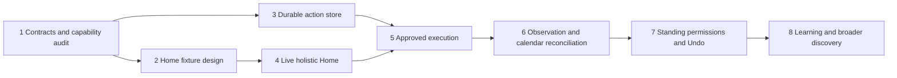

# Assistant Home and proactive work: build specification

Status: proposed implementation plan. No application behavior changes in this document.
This specification extends the [research plan](proactive-assistant.md).
Its Home design supersedes the feature-focused layout in that plan.

## Product decision

Home is the overview of the relationship between the owner and the assistant.
It answers four questions: what needs me, what is happening, what is coming up, and what is ready?
Proactive discoveries join explicit tasks, conversations, questions, approvals, and completed work on this surface.
Home must be useful before an email or calendar connector is enabled.

Home summarizes domain records. Each domain remains authoritative for its own state and actions.
Channels remain the place for conversation. Tasks retain assignments and checklists. Activity retains execution history.
Artifacts retain searchable documents. Memory retains learned context. Settings retain permissions and source controls.
Home links these surfaces through the work they describe instead of duplicating their full interfaces.

The interface uses the existing compact typography, semantic colors, stock controls, and light and dark themes.
The design emphasizes outcomes and decisions. Raw tools, token counts, and model names stay in Activity details.

## Screen design

### Home overview, `/assistant`

The page title is “Home”. Its navigation position precedes Channels.
The header includes source/workspace status and an overflow menu for launch preference and automation controls.
“Ask or start something…” prepares a Main-chat draft. It does not add a second independent chat session or send text automatically.
On narrow screens, this becomes a compact “Ask” button to preserve room for actual work.

```text
Desktop
┌──────────────┬──────────────────────────────────────────┬───────────────────────────┐
│ Home      2  │ Home                         [Ask] [···] │                           │
│ Channels     │ Overview   Following   History           │ Selected item             │
│ Tasks        │                                          │                           │
│ Activity     │ NEEDS YOU                            2   │ Clear outcome             │
│ Workspace    │ Add Friday's show to Personal?           │ Proposed changes          │
│ Settings     │ Oct 23 · 8pm PDT · Fox Theater            │ Source evidence           │
│              │ No guests · Includes seats and tickets   │ What is uncertain         │
│ Channels…    │ [Add event] [Review] [Dismiss]            │                           │
│              │                                          │ [Specific action] [Edit]  │
│              │ Research needs your choice               │                           │
│              │ “Compare all options or only nearby?”    │ Discuss · Permission…     │
│              │ [Choose]                                 │                           │
│              │                                          │                           │
│              │ IN PROGRESS                              │                           │
│              │ Weekend guide · Comparing two routes     │                           │
│              │                                          │                           │
│              │ COMING UP                                │                           │
│              │ Tomorrow · Hotel cancellation deadline   │                           │
│              │                                          │                           │
│              │ READY FOR YOU                            │                           │
│              │ Weekend guide · Report ready [Open]      │                           │
│              │ Show details added [View event] [Undo]   │                           │
└──────────────┴──────────────────────────────────────────┴───────────────────────────┘
```

These are invented fixtures. Dates and source coverage are never fabricated in the live screen.
The inspector appears only after selection. Without selection, the content remains a centered reading column.
Use existing shell breakpoints rather than new device categories. Medium-width windows use the detail sheet instead of squeezing both columns.

```text
Mobile
┌───────────────────────────────┐
│ ☰  Home          [Ask] [···]  │
│ Overview  Following  History  │
│                               │
│ NEEDS YOU                  2  │
│ Add Friday's show?            │
│ Oct 23 · 8pm PDT              │
│ Personal · No guests          │
│ Fox Theater · Seats included  │
│ [Add event] [Review]           │
│ [Dismiss]                     │
│                               │
│ Research needs your choice    │
│ [Choose]                      │
│                               │
│ IN PROGRESS                   │
│ Weekend guide                 │
│ Comparing two routes          │
└───────────────────────────────┘
```

One scroll container owns each tab. Selecting a detail preserves the tab, scroll position, and selected item.
Mobile detail uses a routed, full-height sheet. Direct links render a full detail page with the same content component.
Android Back closes the sheet first. Returning from an email or document restores the reading position.

### What belongs in each section

| Section | Included | Excluded | Default presentation |
| --- | --- | --- | --- |
| Needs you | Live questions and approvals, durable proposals, sign-in blocks, failures with an owner decision | Routine warnings, completed decisions, expired approvals | Up to three expanded decisions, then compact rows and View all |
| In progress | Active owner assignments and useful background work tied to an outcome | Individual tool calls, routine polling, idle sessions | Up to three compact rows with current meaningful progress |
| Coming up | Verified deadlines, scheduled follow-ups, and relevant near-term events | A full calendar, guessed urgency, every task without a due date | Three chronological rows with absolute dates on detail |
| Ready for you | New reports, useful completed work, automatic-action receipts, and relevant updates | Every run completion or unchanged heartbeat | Up to five rows, grouped by work item |

Empty sections disappear. An empty Home says “You’re caught up” with source freshness and links to active work.
One action can remain accessible from several surfaces, but it appears once in the Home overview.
A task blocked on approval appears under Needs you, not again under In progress.
A task producing an artifact becomes one completion row with an artifact link, not separate task, run, and document notifications.
Use stable task, action, run, and artifact relationships for grouping. Title similarity cannot merge unrelated records.

Unread and unresolved are separate states. Opening a report marks it read. Opening an approval does not resolve it.
The Home badge counts unresolved owner decisions. Routine completed work uses a quiet unread marker within Home.
Channel unread indicators remain conversation-specific.

### Ordering and attention

Start with deterministic ordering: verified imminent deadlines, blocking decisions, then other decisions by age.
New arrivals must not reorder the card under the pointer or move keyboard focus during a decision.
Current selection stays anchored until the interaction ends. The page can show a “New updates” affordance for deferred insertions.
After resolution, the card briefly shows its result before leaving Needs you. Focus moves to the next item heading or section heading.
Do not use model-generated urgency labels without evidence of an actual deadline or blocker.
No global Approve all button in the initial release.

### Action detail, `/assistant/actions/:id`

Read order: outcome → target and effects → changed fields → evidence → primary action → supporting controls.
An existing-event edit shows “Current” and “Proposed” values. Creation shows only proposed values.
The primary action names the mutation. “Approve” alone is insufficient when “Add event” is available.
Missing required information replaces execution with “Choose time” or another specific resolution step.

Edit opens typed domain fields. Saving creates a new revision and returns to its review, with a new payload hash.
Discuss prepares a draft in the selected channel with the action link and preserves existing draft text.
Dismiss is an instance decision. Snooze and future suppression remain separate actions in the overflow menu.
“Allow similar actions…” opens a permission scope sheet. Saving the scope never silently approves a different pending revision.

One-tap execution is available only when the card already displays enough information for that exact action.
Shared targets, external recipients, or irreversible effects require review before the final execution control.
Existing live approvals retain their original scope and expiration. Home cannot revive them as durable approvals.

### Following, History, and preferences

Following has two groups: “Situations” and “Ongoing help”.
Situations include a trip, booking, project dependency, or promised follow-up.
Ongoing help includes explicit responsibilities and clearly labeled suggestions inferred from repeated useful work.
Rows show the current status, next observation, and source links. Pause and Stop following have explicit scopes.

History groups decisions and outcomes by day, with search and status filters.
It links to the canonical domain record and Activity run. It does not duplicate the complete tool trace.
Undo remains available from a receipt while safe reversal is supported, even after the item leaves Overview.

Memory → Preferences shows confirmed and inferred entries, their evidence, and Edit/Forget controls.
Settings → Permissions shows account and resource scopes, action limits, and Revoke.
These destinations are linked from Home settings. They are not extra top-level Home tabs.

### Setup and degraded states

Home opens with existing work immediately. Connector setup is a small contextual invitation, not a blocking onboarding wizard.
Background observation setup selects account, scope, and bounded lookback. Calendar execution separately selects a target calendar.
The first discovered proposal offers approval-required execution. Automatic behavior is available only after a visible standing grant.

Each section has independent loading and error state. A calendar outage cannot hide a completed report or a chat approval.
Show “Email checked 10 minutes ago; calendar unavailable” instead of a misleading global “All checked”.
On offline devices, keep cached content and disable execution. Do not queue approval mutations silently for later delivery.
Show “Saving decision”, “Queued”, “Working”, and “Completed” as distinct states.
An uncertain provider outcome says “Checking whether this completed” and disables blind retry.

## Shared records and contracts

Home introduces a read model over existing records, not a new universal work store.
Durable actions and situations add new state only where the current domains lack it.

```ts
// Contract sketches. Implement as strict Zod schemas in orchestration.
type HomeEntity =
  | { kind: "live_request"; requestId: string; conversationId: string }
  | { kind: "action"; actionId: string; revision: number }
  | { kind: "task"; taskId: string; revision: number }
  | { kind: "run"; runId: string }
  | { kind: "artifact"; artifactId: string }
  | { kind: "situation"; situationId: string; revision: number };

type HomeItem = {
  id: string;                 // Stable presentation identity, not an authorization token.
  entity: HomeEntity;
  group: "needs_you" | "in_progress" | "coming_up" | "ready";
  title: string;
  summary?: string;
  updatedAt: string;
  deadlineAt?: string;        // Evidence-backed only.
  related: HomeEntity[];
  read: boolean;
  capabilities: string[];     // Validated UI affordances, never raw execution arguments.
};

type HomeSection = {
  status: "ready" | "partial" | "unavailable";
  items: HomeItem[];
  total: number;
  nextCursor?: string;
  asOf: string;
};

type ActionDecision = {
  actionId: string;
  revision: number;
  payloadHash: string;
  decision: "approve" | "dismiss";
  requestKey: string;
};
```

The server derives enabled controls from current state. Clients cannot authorize actions by altering `capabilities`.
Existing tasks and artifacts keep their current IDs. Stable relationships provide the Home deduplication key.
Persist read, hidden, and snoozed presentation state separately from execution state.
Hiding a completed item cannot cancel work. Snoozing a card cannot grant permission.

Keep the research plan's Observation, Situation, Preference, Responsibility, PermissionGrant, and ActionAggregate records.
Add `HomePresentation` with `entityKey`, `readAt`, `hiddenAt`, and `snoozedUntil`.
For grouped work, persist presentation against the stable work identity and version of the meaningful outcome.
A new substantive result can become unread without reopening an already resolved decision.

### Transport and module boundaries

Add `GET /api/assistant/home` as a versioned aggregate endpoint. Keep `/api/home` compatible until existing Inbox consumers migrate.
Fetch gateway-owned live requests and workspace-owned work independently, with explicit partial coverage.
Return canonical records and bounded section pages. Home never fetches complete chat histories to compute its overview.
The gateway joins read projections. The workspace owns durable action mutations and execution.

Use `src/orchestration/assistantContracts.ts` for wire schemas and `src/workspace/assistant/` for domain logic.
Add `src/surfaces/web/assistantRoutes.ts` for authenticated transport and Home aggregation.
Use existing gateway request authentication and request-origin protection for decision endpoints.
The owner identity comes from that authenticated route, never the request body or model output.

The web feature exports `AssistantScreen`, `ActionCard`, `ActionDetail`, and its store through `features/assistant/index.ts`.
Chat imports the public action-card export. Assistant does not import chat internals, preventing a circular feature dependency.
Routes compose existing chat-request renderers with Home data where live-request behavior is needed.
Generic visual primitives stay in `ui/`. Domain-specific permission and action logic stays in the assistant feature.
Transport types and realtime invalidation stay in `core/`, which must not import feature stores.

### Reusable components

| Component | Responsibility | Existing primitive |
| --- | --- | --- |
| AssistantScreen | Overview, Following, History, independent section state | TabbedScreen, ScreenContent, Section |
| HomeWorkRow | Compact task, result, deadline, or situation summary | Existing row conventions and stock Button |
| ActionCard | Complete small decision with explicit effects | Stock Card and decision Button spacing |
| ActionDetail | Shared desktop inspector, mobile sheet, and direct page content | DetailScreen and RoutedSheet |
| ActionDiff | Typed field comparison, wrapping values, time-zone labels | Semantic definition lists or tables |
| EvidenceList | Source labels, timestamps, and accessible links | Existing link and disclosure patterns |
| OutcomeReceipt | Result, source record, Activity link, conditional Undo | Compact row with expanded details |
| PermissionScope | Preview and grant exact future authority | Field, RadioGroup, Switch |
| CoverageStatus | Per-source freshness and recovery | Existing status and connection patterns |

Use skeletons only for first load. Preserve existing content during background refresh.
Maintain 48px coarse-pointer hit areas through stock controls and the existing decision spacing rules.
Live-region announcements describe decisions without moving focus. Reduced motion removes panel animation.
The implementation updates `web/docs/ux-guidelines.md` to establish Home's role alongside Channels, Tasks, and Activity.

## Build order and review units

The first two units can proceed independently against a frozen wire contract. The dependency graph describes work ordering, not agent delegation.



### 1. Freeze contracts and audit connector capabilities

Deliver strict schema fixtures for Home, action revisions, decisions, receipts, and permission scopes.
Inspect actual Fastmail and calendar tool schemas without reading private content unnecessarily.
Record supported account identity, pagination, privacy metadata, conditional updates, idempotency, and readback.
Specify a capability adapter for each supported calendar operation. Unknown connector tools remain outside automatic execution.
Prototype atomic durable transitions, restart recovery, and one shared workspace writer.

Acceptance: supported operations and fallback paths are explicit. The wire contract distinguishes live requests from durable proposals.
Unknown calendar providers do not block fixture design, but they block claims of a working calendar adapter.

### 2. Build and review the Home design in development fixtures

Deliver Overview, action review, edit, result, Following, and History using the shared component contracts.
Include desktop and mobile states for existing work, not only ticket proposals.
Fixture examples include a blocked research task, a completed artifact, a live approval, and a scheduled follow-up.
Include first-use, empty, partial failure, offline, long values, stale actions, and conflicting Undo.
Keep fixture screens out of production navigation until their APIs exist.

Acceptance: a user can find a decision, inspect the change, act, and locate the outcome without needing to type a prompt.
Review desktop/mobile in both themes once, fix the observed issues, then run one confirmation pass.
Check keyboard focus, Android Back, browser return, and scroll restoration.

### 3. Implement the durable action store and command service

Deliver versioned document families, immutable presented revisions, strict state transitions, and idempotent owner decisions.
Persist action status, exact decision, execution intent, and pending delivery together.
Add restart recovery and reconciliation state without external mutations yet.
Expose local proposal tools to agent sessions. These tools cannot approve, grant authority, or execute external writes.
Do not extend the lifetime of `ChatAsks` promises as a substitute for persistence.

Acceptance: a proposal survives a workspace restart. Repeated decisions return the same result.
Old revision hashes and unauthenticated actors cannot authorize execution. Expired live approvals cannot be converted into grants.

### 4. Connect holistic Home to real app records

Deliver aggregate routes, canonical entity links, independent section recovery, pagination, and presentation state.
Include live cross-channel questions, task/run progress, artifacts, due scheduled checks, and durable proposals.
Only show calendar-derived upcoming items after their source adapter provides real data.
Add Home navigation and optional launch preference. Preserve `/chat`, `/inbox`, and historical push links.
Existing Inbox entries become alternate views of canonical records rather than another action queue.
Update realtime handling so resolving an action in chat updates Home and vice versa.

Acceptance: Home is useful with no connectors. A task/report/run group produces one outcome row.
One unavailable domain does not blank the page. Refresh and reconnect do not resurrect resolved decisions.
The owner can reach each complete domain screen from its summary.

### 5. Add approved calendar execution and receipts

Deliver the first validated calendar adapter and exact-action executor.
Dispatch only after current permissions, resource state, evidence, revision, and expiry pass host checks.
Persist intent before writing, then read back the external result before showing completion.
Reconcile unknown outcomes before retrying. Persist an operation key across attempts.
Expose execution receipts in Home, chat links, and Activity.

Acceptance: one approved fixture-backed booking reaches a real adapter test boundary and produces the expected event payload.
System tests use fake external providers. Live account trials use an explicitly selected test calendar and reversible fixtures.
Tests cover crashes before and after provider acceptance, changed guests, stale target versions, and duplicate approval clicks.

### 6. Add source observation and calendar reconciliation

Deliver scoped source subscriptions, ingest and processing cursors, evidence references, and situation matching.
Split observation, reasoning, and notification budgets in heartbeat.
Normalize ticket evidence and match existing calendar records before preparing a proposal.
Use bounded general discovery alongside due situations. Booking detection is the first tested domain, not the only permitted situation type.
Show partial coverage honestly and use existing wakeups for follow-up checks.

Acceptance: repeated polls and forwarded tickets do not duplicate proposals or events.
Missing dates, ambiguous time zones, and failed calendar searches produce questions or abstention.
Notification caps suppress interruption without stopping ingestion. External content cannot change permissions.

### 7. Add standing permissions and conditional Undo

Deliver the scope editor, host-owned grants, revocation, limits, and automatic private-calendar actions.
Complete reversal adapters and preserve before/after receipts.
Automatic creation requires a known private target and no guests. Automatic enrichment changes only allowed missing fields.
Creation and enrichment are separate scopes. Shared events and time changes retain exact review.
Pause automation prevents new dispatches and shows any action already in flight.

Acceptance: revocation prevents queued dispatch. A receipt names the grant used.
Undo cannot overwrite later owner edits. Unsupported reversals never display a false Undo promise.
Nested codemode execution follows the same checks as direct execution.

### 8. Add inspectable learning and broader discovery

Deliver feedback records, preference retrieval, candidate responsibilities, review dates, and suppression.
Use explicit corrections first. Inferred preferences retain evidence and contradiction links.
Acceptance does not grant authority. Silence does not imply preference. A connector failure does not imply disinterest.
Add replay scenarios for follow-up obligations, new report evidence, and unresolved trip logistics.
Reuse tasks and artifacts for substantial work rather than introducing another job system.

Acceptance: repeated corrections change future proposals in the expected scope.
Forgetting a preference prevents immediate relearning from identical evidence.
The same runtime handles useful non-calendar situations without new Home components.

## Milestones and release gates

| Milestone | Units | Owner-visible result |
| --- | --- | --- |
| A: Home and prepared work | 1–5 | A holistic Home with existing work, durable proposals, one-tap approved actions, and receipts |
| B: Proactive private help | 6–7 | The assistant finds bookings, reconciles them, and acts within selected permissions |
| C: Adaptive assistance | 8 | Corrections and outcomes improve suggestions across ongoing situations |

Milestone A can ship useful Home integration before automatic discovery is enabled.
External automatic actions stay disabled until Milestone B's grant, replay, and recovery tests pass.
No runtime flag hides a supposedly live screen with incomplete APIs. Use development fixtures until the production contract is ready.

For each implementation unit, run relevant root tests and type checks.
For UI units, run web check, lint, build, and targeted browser tests, then the required CI suite.
The end-to-end gate covers gateway authentication, workspace restart, provider failure, and duplicate decision delivery.
Add an explicit rollback path: disable new dispatches while preserving pending proposals and execution receipts.
An in-flight external call is reconciled, not assumed canceled by deployment or rollback.

## Design review checklist

The review examines the first viewport, one approval flow, one existing-task flow, and one completed-document flow.
The owner must be able to distinguish “needs a decision”, “working”, “upcoming”, and “ready”.
Home must remain useful with zero proactive discoveries and zero connected accounts.
The review also includes a busy day with many updates and a quiet day with none.
Success means fewer places to inspect, clear outcomes, and fewer prompts to type.
Counts, engagement, and the number of suggestions are not success measures by themselves.

The next concrete build unit is contracts and capability audit, followed by the fixture-based Home design.
The research architecture remains applicable. Home now covers the whole assistant instead of functioning as a calendar automation inbox.
