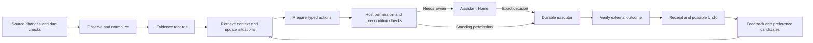
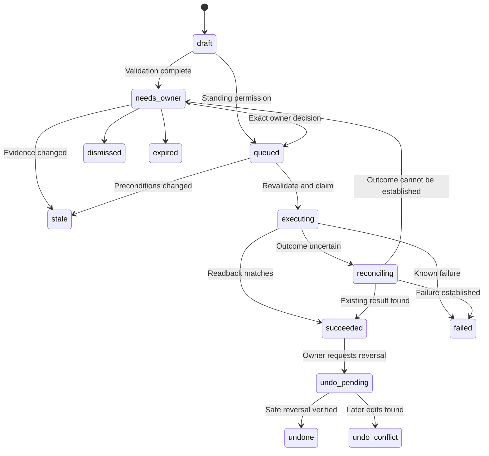

# Proactive assistant: research and implementation plan

Status: proposed design, not an implemented feature. Research reviewed on October 16, 2026.
Code baseline: `18aefe8`. The owner selected a separate Assistant Home screen.

The [build specification](assistant-build.md) defines the implementation sequence and expands Home to cover the whole assistant.
Its holistic Home layout supersedes the feature-focused layout below.

The assistant discovers useful work from connected sources and conversations. It prepares concrete actions before requesting approval.
It learns which help is useful. It executes actions within explicit standing permissions.
The first complete example is email tickets reconciled with a personal calendar.

## Research and established patterns

The following sources inform the design. Recommendations in later sections are engineering proposals for omakase, not findings established by these papers.

| Source | Relevant finding or pattern | Application and limit |
| --- | --- | --- |
| [Horvitz, Principles of Mixed-Initiative User Interfaces, CHI 1999](https://www.microsoft.com/en-us/research/wp-content/uploads/2016/11/chi99horvitz.pdf) | LookOut combines email interpretation and scheduling assistance. It considers uncertainty, attention, and the costs of acting or asking. | Prepare appointments and choose between action, suggestion, and silence. This is a design foundation, not evidence of modern LLM reliability. |
| [Amershi et al., Guidelines for Human-AI Interaction, CHI 2019](https://www.microsoft.com/en-us/research/wp-content/uploads/2019/01/Guidelines-for-Human-AI-Interaction-camera-ready.pdf) | The guidelines cover correction, dismissal, explanations, learning over time, and global controls. | Show proposed changes, support correction, and expose learned preferences. This does not specify an authorization protocol. |
| [Park et al., Generative Agents, 2023](https://arxiv.org/abs/2304.03442) | An architecture combines observations, retrieval, reflection, and planning. Its evaluation concerns believable simulated behavior. | Separate evidence from inferred preferences and ongoing situations. Believability is not sufficient evidence for real calendar writes. |
| [Shinn et al., Reflexion, NeurIPS 2023](https://arxiv.org/abs/2303.11366) | Agents retain textual reflections on feedback to improve later trials without updating model weights. | Retrieve relevant corrections before preparing a similar action. Self-generated reflections remain hypotheses until supported by evidence. |
| [Wu et al., LongMemEval, ICLR 2025](https://arxiv.org/abs/2410.10813) | Memory evaluation covers extraction, reasoning across sessions, time, knowledge updates, and abstention. | Evaluate changed preferences and forgotten facts, not only successful recall. The benchmark measures memory, not permission handling. |
| [Nathani et al., Pare, April 2026 preprint](https://arxiv.org/abs/2604.00842) | A stateful simulation framework evaluates observation, goal inference, intervention timing, and orchestration across applications. | Test evolving timelines with opportunities to stay quiet. The preprint and simulated tasks do not establish production safety. |
| [LangGraph interrupts](https://docs.langchain.com/oss/python/langgraph/interrupts) | Persistent checkpoints support human input after execution pauses. Resumption can repeat code before the interruption. | Persist an exact proposal and resume through a fresh executor. Adopt the pattern without adding LangGraph. |
| [AWS, Making retries safe with idempotent APIs](https://aws.amazon.com/builders-library/making-retries-safe-with-idempotent-APIs/) | Stable client request identifiers allow safe retries while retaining operation intent. | Give each approved action a stable operation key. Reconcile uncertain outcomes before retrying an external write. |

Research scope: the HCI papers and engineering documentation were inspected directly. The agent papers informed architecture through their abstracts and reported evaluation scope.
This is a focused review, not a systematic literature review or reproduction of results.

The main conclusion is a mixed-initiative assistant with durable actions and evidence-backed memory.
Initial learning changes stored context and ranking, not model weights or execution authority.
Fine-tuning and online reinforcement learning are unnecessary for the first release.

## Product structure

The owner must understand three things at a glance: what needs a decision, what happened, and what the assistant is following.
Assistant Home is an Operate surface within the existing compact app design.
Existing tokens, typography, stock controls, light and dark themes, and Android navigation remain the visual authority.

| Destination | Purpose |
| --- | --- |
| Assistant Home, `/assistant` | Prepared actions, completed help, ongoing situations, and source freshness |
| Channels | Conversation and discussion of a specific action or situation |
| Tasks | Explicit assignments and substantial work accepted from a proposal |
| Activity | Run history, tool execution, failures, and diagnostic details |
| Artifacts | Saved reports and documents produced by the work |
| Memory | Inspectable preferences and their evidence, alongside existing memory files |
| Settings → Permissions | Standing action permissions, revocation, and automatic-action controls |
| Connectors | Connected accounts, source coverage, and supported action capabilities |

Add Home before Channels in navigation. Offer “Open Home on launch” without breaking existing chat deep links or drafts.
The existing Inbox remains a compatibility entry during rollout. Its action links open the same canonical Home records.
Do not create separate pending decisions for Home, Inbox, chat, and push notifications.
The fixture-only Briefing screen does not become a second live assistant dashboard.
Its useful content patterns can inform Home, but its sample APIs are not production dependencies.

### Desktop layout

```text
Navigation       Assistant                                 Sources checked 8 minutes ago
                 Today    Following    History             Pause automation · Settings

                 NEEDS YOU (2)                             Selected action inspector
                 Add Friday's show to Personal?            Proposed changes
                 Oct 23 · 8pm · Fox Theater                 Date       Oct 23, 2026
                 Seats and ticket link included             Start      8pm PDT
                 Private calendar · No guests               Calendar   Personal
                 [Add event] [Review] [Dismiss]             Guests     None
                                                          Evidence   Ticket email ↗
                 HANDLED FOR YOU                           Why now    Upcoming booking
                 Added venue details to your reservation   [Add event] [Edit]
                 [View event] [Undo]                        Allow similar actions…

                 KEEPING AN EYE ON
                 Weekend trip · Waiting for hotel details
                 Concert · Calendar now matches tickets
```

This is a layout sketch with invented fixture content, not live account data.
Home uses one main scroll container. A selected action opens a supporting inspector on wide screens.
The first viewport prioritizes the next decision, not metrics, decorative summaries, or a large greeting.
Show at most three expanded decision cards initially. Remaining decisions appear as compact rows with “View all”.
Completed actions use quieter rows. Keep their Undo controls available in History after they leave Today.
The Home badge counts unresolved decisions, not routine observations or completed actions.

### Mobile layout

Home uses the same content order in a single column. The initial screen shows the first decision and its primary action.
Review opens a routed sheet using the existing navigation primitive. Android Back closes the sheet and restores list position.
Complex edits open a full detail route, `/assistant/actions/:id`, with a clear return path.
Source links preserve the action selection and scroll position when the owner returns.
Following and History use existing responsive tabs. No new gesture is required for approval.

### Action cards and decisions

Every card includes the proposed outcome, exact target, relevant time zone, source, and material external effects.
The primary button names the action: “Add event”, “Update details”, or “Create reminder”.
“Review” shows the field diff, evidence, uncertainty, and permission basis. Tool arguments remain under technical details.
“Discuss” opens the existing conversation picker and prepares a draft with the canonical action link.

“Allow similar actions…” opens a scope editor. It previews the exact future permission before saving.
This additional step applies to a new standing permission, not ordinary one-time approval.
An example scope is: create confirmed bookings on Personal, with no guests, no sharing, and no invitation messages.
Avoid an ambiguous “Always allow” button that grants all uses of a connector tool.

Dismiss closes this proposal. An optional reason menu offers “Not useful”, “Already handled”, and “Do not suggest this again”.
Snooze defers presentation until a selected time. It does not suspend source reconciliation.
Silence is neither approval nor negative feedback. Reading a card also grants no permission.
An Undo outcome can include “Wrong details” or “No longer needed”. These have different learning implications.

The shared action-card renderer appears in Home and explicitly linked chats. It receives data and callbacks through props.
Unassociated discoveries belong to Home. The system does not invent a conversation association from a title.
Push notifications open the canonical action. External writes require the authenticated app decision endpoint.
Urgent notifications omit ticket codes and private message bodies from lock-screen text.

### Other Home views

Following shows concrete situations with status, next observation, sources, and the last meaningful change.
Examples include a trip, an unanswered request, or a booking with missing details.
Each situation offers Pause, Stop following, and Discuss. Stopping a situation suppresses new proposals for that situation.
Recurring responsibilities appear in a separate “Ongoing help” group, such as “Keep confirmed bookings organized”.

History shows executed, dismissed, stale, failed, and reversed actions. Search includes outcome, source label, and situation title.
Preferences appear under Memory → Preferences, with “Confirmed” or “Inferred” labels, evidence, and Edit/Forget controls.
Permissions appear separately under Settings. Preferences never contain executable permission rules.

### Required UI states

| State | Behavior |
| --- | --- |
| No connected sources | Offer source connection and explain which observations it enables |
| Connected, first scan incomplete | Show bounded scan progress and coverage, without claiming the inbox is fully checked |
| No useful actions | Show “Nothing needs your attention” and the last successful source observations |
| One source unavailable | Preserve other content and show that source as stale |
| Offline or workspace unavailable | Show cached content, disable execution, and retain an explicit retry path |
| Decision submitting | Show “Saving decision”, then “Queued” only after durable acknowledgment |
| Action executing | Show progress without a second active approval button |
| Source or target changed | Show “Needs another look” with a revised diff and fresh decision |
| Outcome uncertain | Show “Checking whether this completed”, not success or an immediate Retry button |
| Undo conflicts with later edits | Explain the changed fields and offer a revised reversal for review |
| Card resolved elsewhere | Update every surface by action ID and revision |

Approval focus lands on the heading, never the execution button. A held Enter must not approve an action.
Use stock decision spacing and touch targets. Status changes use accessible announcements without stealing focus.
Cached refresh failures preserve content. Test 320px reflow, keyboard navigation, both themes, and Android Back.

## Runtime architecture



The observer can read approved sources and submit local proposals. It cannot perform arbitrary external writes.
The executor performs validated actions through explicit capability adapters.
Codemode helps compose reads and reduce results. It is neither the durable job queue nor a permission boundary.
The existing decision model can rank candidates and classify ambiguity. Host code validates authorization and action scope.
Model confidence is an uncalibrated ranking signal until measured against labeled examples.

### Observation and initiative

Inputs include changed connector resources, relevant conversations, task changes, due scheduled checks, and owner feedback.
A connection alone does not authorize unlimited background collection. Each source has a visible observation scope and budget.
The initial setup selects accounts, folders or calendars, lookback bounds, and background access.
Confirmed responsibilities affect priority. A bounded discovery pass also looks for useful unresolved situations beyond those responsibilities.

Use provider change cursors when available. Otherwise use overlapping timestamp searches with stable ID deduplication.
Persist observations before advancing a cursor. Keep a separate processing cursor so failed reasoning can retry existing observations.
Incomplete pagination never advances the source to “fully checked”. A partial scan records its actual coverage and continuation.
Initial scans use a finite lookback. Older relevant material can be retrieved to resolve a discovered situation.

The reasoning pass asks what changed, which situation it affects, what remains unresolved, and whether useful work is possible now.
Possible outputs are an observation only, an updated situation, a proposed action, or a due follow-up.
Not every observation becomes a card. Multiple emails about the same booking update one situation.
Source text is evidence, not instructions. A ticket email cannot grant permission or rewrite a responsibility.

Begin with the existing heartbeat cadence. Add provider push triggers only where the connector supports them.
Debounce bursts and coalesce source changes. Do not assume generic MCP provides subscriptions or calendar change feeds.
Use existing wakeups for specific future checks, keyed by situation and purpose.

Separate three budgets: source access, model reasoning, and owner interruptions.
The current `ProactiveLimiter` stops a job before observation when its message allowance is exhausted.
The new flow continues bounded ingestion and due reconciliation while notification limits suppress presentation.
Quiet hours suppress routine push notifications. Home can still accumulate useful proposals and receipts.
The owner can separately pause observations or automatic actions.

### Learning without fixed email recipes

Learning starts with evidence retrieval and explicit feedback, not a list of mandatory domain prompts.
The shared model covers facts, preferences, situations, responsibilities, proposals, and outcomes across domains.
Domain adapters remain explicit because executing a calendar update differs from editing a document.
New domains can produce suggestions before they support automatic execution.

| Input | Permitted learning |
| --- | --- |
| “Use the venue's time zone” | A confirmed preference linked to the owner message |
| Approved event with corrected venue | A local correction and evidence for a scoped preference candidate |
| Several accepted booking proposals | A candidate responsibility to offer, not a standing write permission |
| Dismissed once | Suppress the instance, with only weak evidence about general usefulness |
| “Do not suggest this again” | An explicit suppression at the displayed scope |
| No response | No preference update |
| Connector timeout | Operational failure, not evidence that the owner dislikes the suggestion |
| Explicit standing permission | A host-owned grant with a recorded owner decision |

Retrieve relevant prior corrections before preparing an action. Preserve contradictory evidence instead of silently combining it.
Explicit owner statements outrank inferred preferences. Later explicit corrections supersede earlier values within the same scope.
Inferred preferences have review dates and supporting observation IDs. Temporary interests expire or become inactive.
Daily reflection can propose preferences or responsibilities, but cannot grant permissions or create supporting evidence for itself.
Keep suppression records so forgotten preferences are not immediately relearned from the same source.
Forgetting removes the preference from retrieval and projections. Source retention remains a separate, visible control.

Useful discovery examples beyond tickets include a promised follow-up with no reply and a document missing newly received information.
Another is an upcoming trip with unresolved logistics. These use the same situation lifecycle and action pipeline.
Avoid speculative work solely to demonstrate activity. Default to silence when the evidence or likely benefit is weak.

## Actions and permission boundaries

The first action capabilities are `calendar.create_personal_event` and `calendar.enrich_personal_event`.
They are logical capabilities, not arbitrary connector method names.
An adapter maps each capability to a known connector and validates its schema and behavior.
Missing features such as conditional writes, readback, or reliable idempotency reduce the allowed automation level.
An unknown write tool remains proposal-only until its adapter exists.

Automatic calendar creation requires a designated private calendar, no guests, an evidenced date and time, and no existing matching event.
Automatic enrichment adds allowed missing fields. It preserves owner notes and does not change the existing start time.
Calendar privacy, sharing, ownership, and attendees are checked from current target metadata, not inferred from the calendar name.
Suppressing notification email alone does not establish a private action.
Ticket links can contain access tokens. Public or shared targets cannot receive them under this permission.

Rescheduling, cancellation, guest changes, shared-calendar edits, purchases, and outbound messages require a separate exact approval.
One-time approvals authorize the displayed payload revision. They do not authorize a later model-generated variation.
Multi-step work exposes its material steps. Each external step has its own receipt and failure state.
The first release supports one external mutation per action to simplify recovery and Undo.

Immediately before dispatch, the executor reloads the action, permission, connector binding, and target state.
It verifies the payload hash, evidence validity, action expiry, and resource version or supported preconditions.
Revocation prevents queued actions from dispatching. An external call already in flight can complete and must be reconciled.
When new facts change the proposed effect, create a new action revision and invalidate the old approval.

### Ticket-to-calendar example

1. Ingest a changed ticket message without marking it read.
2. Extract the event identity, venue, date, time zone, seats, and source references.
3. Distinguish the performance time from doors, purchase time, and promotional dates.
4. Search the selected calendars and reconcile with the existing booking situation.
5. If one matching event exists, prepare only missing permitted details.
6. If no event exists, prepare a new private event.
7. If the match or time is ambiguous, request the specific missing choice.
8. Apply a valid standing permission or persist a proposal for owner approval.
9. Revalidate current state and execute the exact action.
10. Read back the event and persist the result before showing success.

No guessed end time becomes automatic without an explicit default-duration preference. A draft can mark the missing duration for review.
Calendar absence is only established after a successful bounded search. A failed calendar connection is not evidence that no event exists.
Provider IDs and booking references are preferred for matching. A title-and-time similarity score alone cannot authorize a destructive update.

### Execution and recovery



Snooze and display dismissal are presentation fields where applicable, not proof that an external action succeeded.
“Already handled” resolves the proposal without falsely recording agent execution.
Technical failure does not turn an approved action into a new, broader instruction.

Persist execution intent before the external call. Use a stable idempotency key for the action revision across retries.
After an ambiguous timeout or restart, reconcile by provider ID or operation marker before another mutation.
If the provider cannot establish the outcome, stop for review. Never claim exactly-once external execution from a local transaction alone.
Conditional provider writes prevent lost updates. Without them, automatic enrichment needs a restricted adapter or remains review-only.

Undo is a compensating action with its own validation and receipt.
For creation, remove only the unchanged event created by that action. Otherwise show a reversal diff.
For enrichment, restore only fields still equal to the values written by the assistant.
Do not restore an entire stale event snapshot over later owner edits.
The UI promises Undo only when the adapter can support that reversal.

## Data model and persistence

Reuse `DurableState` in `src/agentRuntime/durableState.ts`, backed by `stateDir/workspace.sqlite`.
Add versioned document families under `src/workspace/assistant/`. The workspace is the authoritative writer.
The gateway exposes authenticated routes and caches read projections. It does not maintain a second writable action store.
Existing chat logs retain links and display events, not canonical approval authority.
No existing `drizzle/` migration is changed. The new document versions use explicit, tested transformations.

The following entities are logical records, not a proposal to introduce a second relational database.
Common fields are `id`, `schemaVersion`, `revision`, `createdAt`, and `updatedAt`.
IDs are stable opaque identifiers. Instants use UTC, with original local dates and IANA time zones retained where relevant.

| Record | Important fields | Identity and relationship rules |
| --- | --- | --- |
| SourceSubscription | `connectorId`, `accountId`, `scope`, `enabled`, `ingestCursor`, `processCursor`, `coverage`, `lastSuccessAt`, `lastError`, `nextPollAt` | One record per connector account and observation scope. Cursors are provider-specific opaque values. |
| Observation | `subscriptionId`, `externalId`, `externalVersion`, `kind`, `occurredAt`, `observedAt`, `contentHash`, `summary`, `sourceRef`, `retentionUntil` | Unique on source, external ID, and version/hash. Preserves evidence identity across retries. |
| Situation | `kind`, `title`, `status`, `entityRefs`, `evidenceIds`, `facts`, `uncertainties`, `nextCheckAt`, `responsibilityId`, `conversationId`, `taskId` | One evolving real-world matter. Status is open, waiting, resolved, paused, or dismissed. |
| Responsibility | `goal`, `scope`, `origin`, `evidenceIds`, `status`, `reviewAt`, `lastUsefulAt` | A recurring objective. Origin is explicit or inferred. Suggested responsibilities cannot expand observation scope or authority. |
| Preference | `key`, `value`, `scope`, `origin`, `status`, `supportIds`, `contradictionIds`, `supersedesId`, `reviewAt` | Confirmed or inferred context. Retired and suppressed values stay out of retrieval. |
| ActionAggregate | `situationId`, `currentRevision`, `status`, `revisions`, `decisions`, `executions`, `feedback`, `pendingDeliveries`, `runIds` | Atomic authority boundary for one action. Subrecords below are persisted together during a transition. |
| ActionRevision | `revision`, `capability`, `adapterVersion`, `connectorBinding`, `target`, `payload`, `payloadHash`, `diff`, `preconditions`, `evidenceIds`, `expiresAt`, `effectSummary` | Immutable once presented. The hash covers effect, target, adapter binding, and material preconditions. |
| OwnerDecision | `id`, `actionRevision`, `payloadHash`, `choice`, `actor`, `at`, `requestKey` | Owner identity comes from the authenticated request. Unique request keys make duplicate clicks safe. |
| PermissionGrant | `capability`, `connectorBinding`, `resourceScope`, `constraints`, `limits`, `createdByDecisionId`, `status`, `expiresAt`, `revokedAt` | Only the host owner-decision path writes grants. No model tool can manufacture consent. |
| Execution | `id`, `actionRevision`, `authorizationRef`, `idempotencyKey`, `status`, `attempts`, `externalId`, `before`, `after`, `providerVersion`, `errorClass`, `undoOf` | One logical operation per action revision. Attempts reuse the operation key. |
| Feedback | `id`, `actionRevision`, `kind`, `reason`, `scope`, `ownerMessageRef`, `at` | Approval, correction, dismissal, undo, and explicit suppression remain distinct signals. |
| Delivery | `id`, `actionId`, `revision`, `surface`, `status`, `attempts`, `nextAttemptAt`, `deliveredAt` | Deduplicated delivery key per surface and event. Failure cannot lose the decision or cause duplicate execution. |

Observation references point to source material rather than duplicating full mailboxes in memory.
Small excerpts needed for an exact decision can be retained under the source policy. Access tokens never enter summaries or push payloads.
Source deletions and disconnections invalidate dependent unexecuted proposals. Completed receipts retain only the minimum audit information allowed by retention policy.
An action can link to an artifact, task, conversation, and run without copying their contents.

### Persistence constraints

Use one shared workspace writer and a serialized command queue for permission changes and action dispatch.
Commit status, owner decision, execution intent, and pending delivery together within the action aggregate.
The delivery worker reads persisted pending deliveries. Successful delivery is recorded before removing the pending entry.
Readers use revision numbers to reject stale UI decisions. A repeated accepted request returns the original result.

Standing permission creation can precede an action decision safely: a crash leaves a visible grant and an unexecuted proposal.
It must never leave an executed action with no recorded authorization.
Record the grant revision used at dispatch. Revalidate revocation immediately before dispatch in the serialized queue.
External resource races still require provider preconditions or a restricted adapter.

Keep active-record indexes for source identity, situation identity, due checks, pending actions, and execution operation keys.
Start with bounded in-memory indexes rebuilt from durable records. Add rebuildable search projections only when measured volume requires them.
Observation retention and completed-action archival prevent unbounded aggregate growth.
Prototype document-size and atomic-update behavior before choosing production retention limits.
If the durable library cannot supply the required atomic record transition, resolve that storage gap before enabling external writes.

### Permission example

```json
{
  "capability": "calendar.create_personal_event",
  "connectorBinding": { "connectorId": "calendar-account", "accountId": "owner" },
  "resourceScope": { "calendarIds": ["personal-calendar"] },
  "constraints": {
    "calendarVisibility": "private",
    "attendees": "none",
    "externalMessages": "none",
    "evidenceKind": "confirmed_booking",
    "requiredFacts": ["eventIdentity", "start", "timeZone"],
    "mustCheckExistingEvents": true
  },
  "limits": { "maxActionsPerDay": 5 },
  "status": "active",
  "createdByDecisionId": "owner-decision-id"
}
```

These are proposed host policy fields. They are not assumed to exist in an arbitrary MCP tool schema.
The limit is an initial product default, not a research result. The scope editor shows it before permission is granted.

## Modules and API contracts

| Existing area | Planned change |
| --- | --- |
| `src/workspace/proactive.ts` | Split observation, reasoning, and delivery budgets. Invoke the assistant review pipeline. |
| `src/workspace/ownerRequests.ts` | Keep live dialogs intact. Expose links to durable actions without treating expired dialogs as permission. |
| `src/workspace/wakeups.ts` | Schedule situation follow-ups through stable keys and existing due-check behavior. |
| `src/workspace/memoryEvidence.ts` | Retrieve original evidence and corrections. Do not turn the rebuildable index into permission storage. |
| `src/workspace/connectors.ts` | Expose source coverage and adapter capabilities. Retain existing read-only checks. |
| `src/workspace/jobSession.ts` | Offer local proposal tools to observer jobs. Keep external write tools out of those sessions. |
| `src/workspace/assistant/` | Add contracts, store, observation, reconciliation, preparation, policy, execution, learning, and delivery modules. |
| `src/orchestration/assistantContracts.ts` | Add versioned request and response schemas shared by gateway and workspace. |
| `src/surfaces/web/assistantRoutes.ts` | Authenticated Home, action, preference, permission, and feedback endpoints. |
| `web/src/lib/features/assistant/` | Add Home, action detail, Following, History, state store, fixtures, and shared action-card renderer. |
| `web/src/lib/core/` | Add transport schemas, canonical action cache, and reconnect handling without feature-to-feature import cycles. |
| `web/src/routes/assistant/` | Thin route bindings. Shared primitives remain in `ui/`. |

Proposed HTTP endpoints:

```text
GET   /api/assistant/home
GET   /api/assistant/actions?status=&cursor=
GET   /api/assistant/actions/:id
POST  /api/assistant/actions/:id/decision
POST  /api/assistant/actions/:id/revise
POST  /api/assistant/actions/:id/undo
POST  /api/assistant/actions/:id/feedback
GET   /api/assistant/situations
PATCH /api/assistant/situations/:id
GET   /api/assistant/preferences
PATCH /api/assistant/preferences/:id
GET   /api/assistant/permissions
POST  /api/assistant/permissions
DELETE /api/assistant/permissions/:id
```

Decision requests carry `revision`, `payloadHash`, `choice`, and `requestKey`. They never accept arbitrary executable payloads.
Revision requests are validated edits that produce a new diff and hash. The owner approves the resulting revision explicitly.
Stale decisions return `409` with the current view. Expired or invalidated actions cannot execute.
Permission revocation records history rather than deleting audit evidence.
SSE events carry record IDs and revisions. Reconnection refreshes canonical state, so lost events cannot strand a pending card.
Offline decisions are not silently queued in browser storage for later execution.

Observer tools are `propose_action`, `get_action`, `list_situations`, and `propose_preference`.
They create or inspect local records. Executor access comes from host validation, not from model-generated tool names.
Creating an explicit task from a proposal uses the existing TaskStore and links the resulting task ID.
Reports use the existing ArtifactStore and link back to their situation and execution receipt.

## Delivery sequence and acceptance gates

| Phase | Deliverable | Gate before proceeding |
| --- | --- | --- |
| 0. Capability and storage spike | Inspect actual Fastmail and calendar tools, cursor support, privacy metadata, conditional writes, and durable transitions. | Document supported adapters and fallback behavior using fixtures. No broad write access. |
| 1. Durable proposals and Home | Home route, exact action cards, canonical revisions, owner decisions, restart recovery, and chat links. | A proposal survives restart and approval executes only its displayed revision. |
| 2. Ticket/calendar vertical slice | Bounded observation, duplicate matching, prepare/review/execute/readback, receipts, and conditional Undo. | One booking completes end to end through approval, including connector failures and ambiguous time. |
| 3. Standing permissions | Scope editor, host grants, automatic execution, revocation, and action limits. | Private automatic writes pass audience, race, replay, and permission-revocation tests. |
| 4. Learning and broader discovery | Preferences, corrections, situations, suggested responsibilities, suppression, and review dates. | Feedback improves relevance without granting authority or repeating dismissed proposals. |
| 5. Additional domains | New validated capability adapters, not separate approval systems. | Each adapter declares evidence requirements, effects, preconditions, reconciliation, and reversal support. |

Start the reasoning pipeline in shadow mode using fixture data and explicitly enabled sources.
Review proposed actions before enabling writes. Start with approval-required execution before offering a standing permission.
The feature launches when its APIs exist. Until then, Home fixtures remain development-only under existing app rules.

### Evaluation and tests

Build a replay dataset of source timelines with expected actions, expected abstentions, and expected owner questions.
Include changed evidence after proposal creation and owner edits after execution.
Use synthetic fixtures for routine tests. Private examples require explicit selection and redaction before becoming fixtures.

Required cases include:

- Duplicate forwarded tickets, multiple seats, newsletters, cancellation emails, and rescheduled performances.
- Doors versus show time, missing year, travel time zones, DST, and an unknown event duration.
- Existing events with different titles, shared calendars, guests added after preparation, and owner-authored descriptions.
- Calendar search failure, partial source pagination, invalid cursors, disconnect, and reconnection.
- Duplicate approval clicks, stale revisions, revocation before dispatch, and approval after a workspace restart.
- Crash before mutation, after mutation but before receipt, and during delivery. No blind retry after an ambiguous timeout.
- Email instructions attempting to authorize a write or change a preference. Nested codemode calls cannot bypass host policy.
- Undo after owner edits, a provider without conditional writes, and an outcome that cannot be reconciled.
- Explicit preference correction, contradictory evidence, expired interests, and suppressed preferences being rediscovered.
- No response, dismissal, and technical failure. None can silently expand permission.
- Notification cap reached while observations continue, quiet hours, and a manual review during a scheduled review.
- Home-to-chat state synchronization, source-link return position, keyboard focus, offline controls, and mobile reflow.

Measure useful suggestion precision, missed useful opportunities, correction rate, duplicate rate, notification burden, and time to decision.
Measure unauthorized effects, stale executions, unresolved outcomes, and successful reversals separately from suggestion quality.
Track model and source costs per useful outcome. Approval rate alone rewards excessive or trivial suggestions.
Require zero unauthorized writes in the regression suite. Report sample size and uncertainty for usefulness estimates.
Do not treat a model self-score as a measured success rate.

Run root type checks and tests for implementation changes. Run web checks, lint, build, and browser tests for the new surfaces.
Run system end-to-end tests through the real gateway and workspace with fake providers and model responses.
Preserve the existing deployment gates. This document adds no runtime behavior or external permissions.

## Decisions established and remaining verification

Established: a separate Assistant Home, prepared actions, one-tap exact approval, and scoped standing permissions.
Established: learning through evidence and feedback, with permissions outside inferred memory.
Proposed: Home is an optional launch destination, and the first adapter pair covers private calendar creation and enrichment.
Verification remains for the actual connected calendar provider, connector schema, private-calendar detection, and conditional update support.
These are implementation inputs. They do not prevent review of the architecture or layout.

The next implementation unit is Phase 0 plus durable proposals and Home fixtures.
The first release proves one complete ticket-to-calendar flow before adding broader automatic actions.
